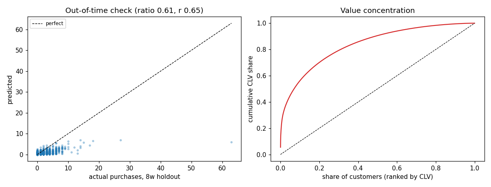

# Customer Lifetime Value Forecasting

BG/NBD and Gamma-Gamma on two years of retail transactions, validated against a window the model never saw.

**Built:** October 2026

## The question

For each customer, how many purchases are expected over the next 26 weeks, how much will each be worth, and does the answer hold up out of time? The out-of-time check is the point of the repo, because a CLV number nobody validates is decoration.

## Data

- **UCI Online Retail II** - UK subset of 1,067,371 transactions, Dec 2009 to Dec 2011
- Source: https://archive.ics.uci.edu/dataset/502/online+retail+ii (CC BY 4.0)
- 5,350 customers, 71 percent repeat buyers, average order value 435.

## Method

- summary_data_from_transaction_data for frequency, recency and T in weeks
- BG/NBD fitted unpenalized (penalizer_coef=0.0), which gives healthy dropout parameters a=0.11, b=2.82; Gamma-Gamma for conditional average profit
- Out-of-time validation: fit to the last 8-week cut, compare predicted against actual purchase counts
- Full-history refit, then CLV ranked over a 26-week horizon at 1 percent weekly discount

## Results

| Metric | Value |
|---|---|
| history_weeks | 105 |
| customers_full_history | 5350 |
| repeat_customers | 3804 |
| repeat_rate | 0.7110 |
| avg_order_value_gbp | 434.6000 |
| bg_params | {'r': 0.7058, 'alpha': 10.3155, 'a': 0.1085, 'b': 2.8219} |
| holdout_weeks | 8 |
| holdout_predicted_purchases | 2,198.2 |
| holdout_actual_purchases | 3586 |
| holdout_calibration_ratio | 0.6130 |
| holdout_rank_correlation | 0.6500 |
| prob_alive_mean | 0.8904 |
| horizon_weeks | 26 |
| weekly_discount_rate | 0.0100 |
| clv_mean_gbp | 3,767.6 |
| clv_median_gbp | 1,519.4 |
| clv_p90_gbp | 6,827.2 |
| top_decile_clv_share | 0.5610 |

### 26-week CLV across repeat buyers (GBP)

| quantile | CLV |
|---|---|
| p10 | 319.76 |
| p25 | 665.29 |
| p50 | 1519.38 |
| p75 | 3425.62 |
| p90 | 6827.19 |
| p95 | 10482.13 |
| p99 | 32016.08 |



*The honest out-of-time check, then value concentration*

## What the numbers mean

The model under-predicts hold-out purchases by about 39 percent while still ranking customers well, with a rank correlation near 0.65. That gap is explainable: the hold-out window is the November to December wholesale peak, which a non-seasonal BG/NBD cannot see coming. Median 26-week CLV is around 1,500 and the top decile holds 56 percent of it, which is the retention-budget argument.

## Limitations

No seasonality term, so holiday peaks are systematically under-forecast. Monetary value comes from historical average order value, which biases toward customers who bought big once. Two years of one UK retailer will not transfer to another business.

## Run it

    pip install -r requirements.txt
    python src/main.py

```
python src/main.py            # requires the dataset in data/ (see data/README.md)
```

## License

MIT
